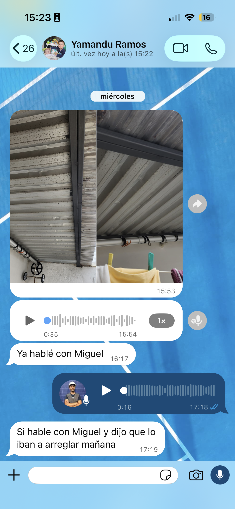

# Manual del Instalador Tercerizado

**Voltia · Uruguay** · Versión 0.2 · del 19/10/26 · *borrador*

> Este manual explica **cómo trabaja con Voltia un instalador tercerizado**: cómo se empieza, qué se le pide, cómo le llega una obra, cómo cobra, cómo se hace y se entrega una obra con el estándar de Voltia, y cómo usa Voltia PM. Es el manual **de consulta de todos los instaladores tercerizados**, en cada obra: no hace falta leer ningún otro manual.

## 0 · Qué es este manual

**Qué es.** El manual de trabajo de quien instala para Voltia sin ser parte de su cuadrilla propia: el **instalador tercerizado**. Es el manual **de consulta de todos los instaladores tercerizados**, los que recién empiezan y los que trabajan con Voltia hace años: cuando hay una duda sobre cómo se hace algo, la respuesta está acá. Está escrito para que lo entienda cualquiera, aunque no conozca a Voltia: no se da nada por sabido.

**Qué no es.** No es un curso de electricidad ni de construcción: explica **cómo se trabaja en Voltia** y qué estándar se espera. Lo que hace falta aprender, Voltia lo enseña con sus capacitaciones (capítulo 2).

**Quién lo lee.** Todos los instaladores tercerizados que trabajan con Voltia, que lo consultan siempre, no solo al empezar, y el gerente de Operaciones de Voltia, que es quien trabaja con ellos. Una buena parte (la seguridad, los criterios técnicos, la puesta en marcha y el cierre) es la misma que sigue la cuadrilla propia de Voltia: está repetida acá a propósito.

**Cómo está armado.** Primero, quién es Voltia y cómo es la relación (capítulos 1 a 4). Después, la obra de punta a punta (capítulos 5 a 10). Al final, cómo se evalúa el trabajo, los errores que ya pasaron, Voltia PM, qué hacer cuando algo sale mal y el checklist. Cierra con las reglas en una página, un glosario y el registro de cambios.

## 1 · Quién es Voltia y cómo trabaja

**Voltia** vende e instala sistemas de paneles solares en Uruguay, en casas, comercios, campos y empresas, y los acompaña después: el trámite ante **UTE** (la empresa eléctrica estatal, que tiene que habilitar cada instalación), el seguimiento de la generación y el mantenimiento.

**El recorrido de una obra.** Cada venta se vuelve un **proyecto**, que avanza por **etapas**, cada una a cargo de un área de Voltia:

| Etapa | Quién | Qué pasa |
|---|---|---|
| Venta y onboarding | Ventas | Se vende, se firma el contrato y se cobra la seña |
| Pre-Ingeniería | Ingeniería | Se diseña la instalación: planos y lista de materiales preliminar |
| Validación de Operaciones | Operaciones | Se le ofrece la obra al instalador, el instalador revisa el proyecto (su **informe**) y se confirma la fecha |
| Ingeniería Final | Ingeniería | Se corrige con lo que dijo el instalador y se cierra la lista de materiales definitiva |
| Compras | Logística | Se compra el material y se le manda el **kit** a la casa del cliente |
| Ejecución de Obra | **El instalador** | Se instala, se configura, se prueba y se deja todo cargado |
| Tramitación UTE | Tramitación UTE | Se hace el trámite para que UTE habilite la instalación |
| Experiencia Solar | Experiencia Solar | Se acompaña al cliente para siempre |

**Con quién habla el instalador:**

| Quién | Para qué |
|---|---|
| **El gerente de Operaciones** | Todo lo de la obra: la oferta, la fecha, las dudas, los problemas, la evaluación del trabajo. Es su referente en Voltia |
| **Logística** | El envío del kit de materiales a la casa del cliente |
| **Ingeniería** | Solo cuando algo del proyecto que dice «siempre» no se puede cumplir (capítulo 8) |
| **El cliente** | Horarios, accesos y la recepción del kit. **Nada más**: de fechas, plazos y cómo sigue todo le habla **Experiencia Solar** |

> **Voltia vive de que cada obra salga en su fecha.** La fecha que se le confirma al cliente se defiende: moverla tiene que ser la excepción.

## 2 · Cómo se empieza a trabajar con Voltia

**Voltia contrata a la empresa, no a su gente.** El instalador tercerizado trabaja por su cuenta: contrata a quien necesite y organiza su trabajo como quiera. Lo que Voltia le exige es **el resultado**: que la obra se entregue completa, **segura** y con el **estándar de Voltia**. Cómo llega a eso es decisión suya.

### El perfil

**Lo que tiene que traer:**

- Manejo de herramientas eléctricas (taladro, rotomartillo, amoladora) y de soldadura.
- Conocimiento eléctrico básico. **No se le pide ningún título ni certificado.**
- Saber **leer e interpretar los planos** que le manda Voltia: el unifilar, los planos de montaje y la lista de materiales.
- **Facilidad para aprender.** No se pide experiencia previa en solar.

**Lo que aprende trabajando con Voltia**, si no lo sabe:

- **Construcción y montaje:** los tipos de tornillo, mecha, anclaje y taco según la estructura; los metales que se oxidan y el **par galvánico** (dos metales distintos en contacto se oxidan entre sí); soldar hierro, acero y galvanizado (de punto y MIG); hacer hormigón para las fundaciones de los montajes en tierra, nivelar con piolas y, a veces, levantar un nicho de ladrillo o bloque y revocarlo.
- **Techos:** cómo se trabaja en cada tipo sin generar filtraciones (capítulo 7) y cómo se camina sobre ellos.
- **Lo solar:** armar los conectores de los paneles (MC4); la corriente continua, que no se corta bajo carga y hace arco; medir con el multímetro y la pinza (tensión de cada string, polaridad, corriente); la puesta a tierra y su medición; el replanteo (medir, orientar al norte, dar la inclinación); cómo se manipulan los paneles.
- **La parte eléctrica de la obra:** cableado y canalización prolijos, y armar un tablero básico.
- **El trabajo en altura:** el arnés, el anclaje y la escalera.
- **Lo digital:** cargar fotos, videos y documentos en Voltia PM y, cuando esté listo, configurar el inversor con su aplicación.
- **Trabajar en la casa de otro:** cómo se habla con el cliente, qué se toca y qué no, y cómo se deja el lugar.

### La capacitación

**El instalador está siempre dispuesto a hacer los cursos y las certificaciones que le ofrezca Voltia.** En general son gratuitos. Puede haber evaluaciones, con un mínimo para seguir trabajando con Voltia.

**La capacitación de seguridad la da Voltia**, con su equipo prevencionista: el instalador y su gente se capacitan **junto con la cuadrilla propia**. Nadie trabaja en altura sin esa capacitación vigente.

### La primera obra

1. **Primero acompaña.** Trabaja por lo menos una obra junto con otro instalador de Voltia.
2. **Después, una obra sencilla, solo.** Lo más crítico (la **configuración de los equipos** y alguna tarea muy específica) la hace Voltia.
3. **La configuración la hace Voltia hasta que decide que el instalador ya puede hacerla solo.** Cuándo está listo lo decide Voltia.

### Las herramientas

Voltia no le dice con qué herramientas trabajar: le exige lo que hace a la **seguridad**, a **medir bien** y a **cumplir el estándar**, y le sugiere lo que hace el trabajo más fácil. Al empezar, Voltia le puede **prestar** alguna herramienta particular (por ejemplo, el telurímetro); en régimen, todo lo exigido tiene que ser suyo.

**Exigido**

| Para qué | Qué |
|---|---|
| La seguridad | Arnés de cuerpo completo, cabo de vida con amortiguador y punto de anclaje · Escalera en condiciones · Casco con barbijo, guantes, lentes y calzado de seguridad · Careta y guantes de soldar · Extintor cuando se suelda |
| Medir | Multímetro que mida corriente continua hasta 1000 V · Pinza amperimétrica · Telurímetro |
| Los conectores | Pinza para armar los MC4 y llave para desconectarlos · Crimpadora de punteras (los terminales de las puntas de los cables) · Pelacables |
| Hacer la obra | Taladro, con mechas para metal y para hormigón del 6 al 14 · Rotomartillo con percutor · Amoladora · Soldadora · Masa (para la jabalina) · Destornilladores y pinzas aisladas · Llaves Allen, francesa y cricket · Remachadora · Mecha copa y mecha cónica · Cinta pasacable · Pistola de silicona · Cinta métrica y nivel · Cinta aisladora · Pala y posera |
| Documentar | Celular con cámara y datos |
| Moverse | **Vehículo propio**: no hace falta camión ni camioneta, alcanza un auto con portaequipaje para la escalera y las herramientas. Los materiales los manda Voltia a la casa del cliente |

**Recomendado**

- Herramientas a batería: taladro, rotomartillo y amoladora.
- Para los pozos de los montajes en tierra: posera, o mini excavadora o retro según la obra. Pala y balde para el hormigón.
- Llaves combinadas o de tubo, pinceta, arco de sierra o caladora, pinza de corte.
- Escuadra, tiza o marcador y piolas. El inclinómetro y la brújula, en el celular.
- Termocontraíble y pistola de calor.
- Alargue y zapatilla, si tiene herramientas enchufables.
- Botiquín.

### La competencia y los clientes de Voltia

- **No trabaja para la competencia:** ni para otra empresa de energía solar ni instalando paneles solares por su cuenta.
- **Sí puede hacer otros trabajos** por su cuenta: instalaciones eléctricas, construcción, lo que sea.
- **No les ofrece sus servicios directamente a los clientes de Voltia** (un mantenimiento, una ampliación): todo lo de un cliente de Voltia pasa por Voltia.

> *Por armar:* el contrato entre Voltia y cada instalador tercerizado, con estas condiciones. Va como anexo.

## 3 · Cómo llega una obra

1. **El gerente de Operaciones le ofrece la obra** con su **presupuesto de mano de obra**: lo que Voltia le paga por esa obra.
2. **El presupuesto no se negocia.** Sale del costeo de la venta, que se hizo antes de que la obra existiera. El instalador **acepta o no**. Pagar más lo autoriza solo el CEO de Voltia.
3. **Si acepta**, el gerente agenda la obra con su equipo. Desde ese momento, el pago queda a su nombre en Voltia PM.
4. **En los 2 días hábiles siguientes a que se confirma la fecha**, el instalador revisa el proyecto y deja su **informe** (capítulo 5).
5. **La fecha confirmada se defiende.** Si algo puede moverla, se le avisa al gerente de Operaciones en cuanto se sabe, no el día de la obra.

**Qué obras le pueden tocar.** Cualquiera: cuál le toca lo decide el gerente de Operaciones, según la obra, la zona y la agenda. Las obras grandes o muy complejas suelen quedar para la cuadrilla propia.

## 4 · Cómo y cuándo se cobra

- **El 50 % al arrancar la obra y el 50 % al terminarla.** La obra está terminada cuando pasó el control de obra (capítulo 11): con todo lo que se entrega y con el estándar de Voltia.
- La orden de pago la da el responsable de Administración y Finanzas o el CEO de Voltia.
- **El instalador ve lo que cobró y lo que le falta cobrar en Voltia PM**, en **Mis cobros** (capítulo 13).
- **Las correcciones corren por su cuenta.** Si hay que volver a la obra para corregir algo, el tiempo y el viaje son del instalador: el trabajo se paga **llave en mano**, terminado y con el estándar de Voltia.

**Empresa, seguro y factura.** Si a un trabajador del instalador le pasa algo en una obra de Voltia, Voltia también responde. Por eso, **antes de su primera obra con contrato**, el instalador está **inscripto como empresa** (aunque sea unipersonal) y tiene la **póliza de accidentes de trabajo del BSE** vigente para todos los que van a la obra. **Si le falta el seguro, se le puede retener el pago.** La **factura** se le exige a los seis meses de firmar el contrato.

## 5 · Antes de la obra: el informe y los materiales

### El informe del instalador

**Cuándo.** En los **2 días hábiles** después de que se confirma la fecha de obra, una vez que el instalador aceptó la obra.

**Qué es.** El instalador trabaja sobre la **pre-ingeniería**, que ya tomó en cuenta lo relevado en la visita de venta: la memoria descriptiva, los planos y, sobre todo, la **lista de materiales preliminar**. Analiza el trabajo que tiene que hacer y cuenta si hay alguna incongruencia o si falta algo. Lo de la visita (las fotos, los videos y el resumen) lo tiene disponible como complemento. Lo que diga es lo que usa Ingeniería para la Ingeniería Final.

**Si la información no alcanza, puede ir.** Si el instalador entiende que con la pre-ingeniería y lo de la visita no alcanza, o le quedan dudas, va a la casa del cliente a verlo, **a su criterio**. Como toda visita, se agenda y se coordina con el cliente antes: no se va sin aviso.

**Qué revisa y cuenta:**

- Si la lista de materiales preliminar cierra con el trabajo que hay que hacer, o si algo sobra, falta o no corresponde. Es lo más importante del informe.
- Si la memoria descriptiva y los planos tienen alguna incongruencia.
- El estado del techo o de la estructura donde va el sistema.
- Los accesos a la obra: para entrar con los materiales y para el camión.
- Dónde están el tablero eléctrico y el medidor de UTE.
- Cualquier problema, diferencia o dato que falte para hacer la obra.

**Cómo se carga en Voltia PM:**

1. Entrar a Voltia PM, desde el celular o la computadora.
2. Ir a **Proyectos**, buscar el cliente y tocar **Ver**.
3. En el recorrido del proyecto, tocar la tarjeta **Validación de Operaciones**.
4. Revisar la pre-ingeniería (memoria descriptiva, planos y lista de materiales preliminar) y cargar el informe: hay **Foto**, **Video** y **Nota**, y un botón amarillo redondo para **grabar un audio**.
5. En la misma pantalla, en **Informe del capataz**, cambiar el estado a **Completado**.

**Los estados del informe:** Pendiente · En progreso · Bloqueado · Completado. Mientras no diga **Completado**, el proyecto no avanza: la Validación no termina y la Ingeniería Final no arranca. **Si no hay nada que cambiar, igual se marca Completado**, con una nota que lo diga. Si a la pre-ingeniería le falta algo para poder opinar, se marca **Bloqueado** y se avisa a quien hizo la visita y al gerente de Operaciones.

### Estudiar el proyecto y planificar

Antes de salir, el instalador estudia el proyecto (planos, unifilar, su propio informe y la lista de materiales definitiva) y planifica el trabajo: qué se hace, en qué orden, con qué equipo y qué herramientas. **Nadie llega a una obra sin saber con qué se va a encontrar.** Antes de la primera obra con una marca de inversor, mira su video en **Capacitación** de Voltia PM.

### Los materiales: el kit en la casa del cliente

Logística manda el **kit de materiales directo a la casa del cliente**, no necesariamente el día que se trabaja, y **el instalador tiene que estar ahí para recibirlo**. Logística coordina el envío con el instalador, y el instalador lo coordina con el cliente.

**Al recibirlo, lo revisa contra la lista.** Si falta algo o llegó algo distinto, le avisa a Logística en el momento, no el día de la obra.

**Lo que se lleva impreso:** los documentos de UTE para que firme el cliente, que se imprimen desde el proyecto en Voltia PM, en **Documentos UTE generados**.

**Si hay hormigón:** antes de que llegue el camión con la arena y la piedra, se acuerda con el cliente **dónde descarga**, en un lugar que después se pueda limpiar.

## 6 · La seguridad

> **Con la seguridad no hay flexibilidad. Si no es seguro, no se empieza.**

**Que Voltia no esté en la obra no quiere decir que nadie mire.** El cliente está ahí y ve todo: es, casi siempre, quien primero avisa si alguien trabaja sin protección. Y si el cliente es una empresa, puede tener sus propios prevencionistas recorriendo la obra.

**La responsabilidad es de todos, por ley.** En Uruguay rige la responsabilidad solidaria: si a un trabajador del instalador le pasa algo, responde el instalador, que es su empleador; responde Voltia, que lo contrató, y responde también el cliente, que contrató a Voltia. El instalador trabaja siempre como si lo estuvieran mirando, porque lo están mirando.

**El equipo de seguridad lo pone el instalador**, y Voltia le exige que se use: **no sirve "en la obra", tiene que estar puesto**. Si alguien de su gente trabaja sin protección, quien lo vea para la tarea hasta que se lo ponga, y se le llama la atención **al instalador**, que es el responsable de su gente.

### En el techo (todo trabajo a 2 metros o más)

- Nadie sube sin la capacitación vigente y sin arnés de cuerpo completo, cabo de vida con amortiguador y un punto de anclaje firme.
- Antes de subir, se revisa el acceso: la superficie, el clima, los anclajes, las escaleras y cómo se rescataría a alguien.
- **Nadie trabaja solo en altura.** Por eso, en cada obra, el equipo es de **dos personas como mínimo**.
- Con lluvia, viento fuerte, superficie resbaladiza o tormenta eléctrica, nadie se queda en el techo.
- **Las herramientas no quedan sueltas en el techo:** van en un bolso o atadas. Una herramienta que resbala rompe un panel o lastima a alguien abajo.

### La escalera

Ya se cayó alguien de una escalera en una obra de Voltia y se accidentó.

- **Atada arriba.** Si no se puede atar, alguien la sostiene abajo mientras otro sube o baja.
- **Sobresale un metro del borde del techo**, para tener de dónde agarrarse al pasar.
- **Bien inclinada:** por cada cuatro metros de altura, la base va a un metro de la pared.
- **Apoyada en piso firme y parejo**, nunca sobre ladrillos o tablas para nivelarla.
- **Se sube y se baja de frente, sin cosas en las manos.** Las herramientas se suben aparte.

### El casco, sobre todo para el que está abajo

En una obra de Voltia, al que trabajaba en el techo se le escapó una pinza; resbaló por la caída del techo y cayó al lado de quien configuraba el inversor en el suelo, sin casco. **Pudo haber sido fatal.**

> **El casco no es para el que está arriba: es para el que está abajo.**

Mientras alguien trabaja en el techo, **nadie se queda trabajando justo debajo del borde**. Si hay que trabajar cerca (el inversor, el tablero), se hace con casco o se espera a que bajen.

### En lo eléctrico

- Solo interviene quien está capacitado.
- **Se trabaja siempre sin tensión**, aplicando en la medida de lo posible las **cinco reglas de oro**:
  1. **Cortar** todas las fuentes de tensión.
  2. **Bloquear** para que nadie vuelva a conectar, y poner un cartel.
  3. **Medir** que no haya tensión, con el multímetro y en cada conductor. Todo tiene tensión hasta medir lo contrario.
  4. **Poner a tierra y en cortocircuito**, cuando se puede.
  5. **Delimitar y señalizar** la zona.
- **Del lado de los paneles no se puede cortar la tensión.** Los paneles generan mientras les da la luz, aunque el inversor esté apagado. Del lado de continua, "sin tensión" quiere decir: con el seccionador de continua abierto y los conectores de los strings desconectados. **Nada se conecta ni se desconecta con corriente circulando**: la continua hace arco.
- Herramientas aisladas e instrumentos con la categoría adecuada.

### Siempre

- Herramientas en buen estado; la que falla se saca de uso.
- Si la tarea pone en riesgo a otros (el cliente, niños, mascotas, vecinos), se delimita y se señaliza la zona.
- Nada de celular trabajando en altura o en un tablero.
- Si se suelda galvanizado, **se suelda ventilado y con protección**: el humo del zinc es tóxico.
- **Cualquiera puede y debe parar una tarea si ve un riesgo grave**, y avisa al gerente de Operaciones. Nadie es sancionado por parar de buena fe.

## 7 · Los techos

**El instalador ejecuta, no diseña.** Si se hace la obra, cómo se fija la estructura y dónde van los anclajes lo define **Ingeniería** en el proyecto. Este capítulo enseña a **reconocer cada techo**, qué se revisa antes y qué no se hace nunca.

> **Lo que más se cuida en un techo es que no entre agua.** Una filtración aparece meses después, en la casa del cliente, y la paga Voltia.

| Techo | Cómo se trabaja | Lo que no se hace nunca |
|---|---|---|
| **Chapa sobre tubular** (de hierro o acero) | Se fija desde arriba con tornillo autoperforante punta mecha, de aluminio anodizado, acero galvanizado o inoxidable. La chapa sella con la arandela de goma del tornillo | Agregar un perfil entre la chapa y el tornillo sin sellar abajo (ver más abajo) |
| **Chapa sobre cerchas** | Los tornillos agarran la cercha desde abajo: no se puede agregar un anclaje desde arriba. Solo si el tornillo sobresale lo suficiente y está sano, se monta la estructura con una tuerca más por arriba | Perforar para "agarrar algo" |
| **Chapa autoportante** (apoyada, sin anclajes) | Con remaches especiales que se abren en estrella del lado de abajo al cerrarse. Voltia todavía no los usó: solo con el proyecto de Ingeniería y según el fabricante | Improvisar una fijación |
| **Isopanel** | **No se perfora.** Se fija con piezas tipo pinza que se aprietan en el engrafado, en las uniones de las placas. Antes, se confirma que la placa está bien fijada a la estructura | Perforar la placa |
| **Hormigón (losa)** | Con bloques de contrapeso calculados por Ingeniería, o con una estructura de acero galvanizado anclada a los pretiles o a los laterales de la losa. Antes, se confirma que el pretil es de hormigón armado sano | Perforar la losa si el proyecto no lo dice |
| **Tejas** | Dos formas: la estructura se ancla por debajo de la teja y sale por el frente, o se perfora la teja y se fija con una pieza con topes de goma. Antes, se confirma que la madera está sana | Perforar con percutor; dejar una teja forzada o sin sellar |
| **En tierra** | Fundaciones de hormigón para las patas de la estructura, niveladas con piolas | Dejar la tierra de los pozos o restos de hormigón en el terreno |

### La chapa con un perfil en el medio

Cuando se agrega un perfil entre la chapa y el tornillo, **la arandela de goma queda arriba del perfil** y la unión entre el perfil y la chapa, por donde pasa el tornillo, **queda sin sellar**. Esa unión se sella **siempre**, con otra goma, silicona o algo que aísle, sea cual sea el material.

### Si hay que perforar la losa

Solo si el proyecto lo dice. **Siempre con tope en la mecha**, para no pasarse, y **sellado con el anclaje químico**. Una vez se perforó una losa para anclar más fácil y apareció una filtración adentro de la casa del cliente: hubo que volver a arreglarla, con todo lo que implica.

### La teja que se perfora

Sin percutor, con mecha para cerámica: el percutor la parte. La goma tiene que sellar, igual que en la chapa.

### Caminar sobre un techo

**Sobre la chapa trapezoidal se pisa solo donde apoya en las correas** (donde va el tornillo), nunca en el medio de la onda: se marca, se dobla y hasta se parte en los bordes, y abre entradas de agua donde nadie perforó. Donde se camina mucho, se pone un tablón. Así quedó, vista desde abajo, una chapa pisada en una obra de Voltia:

### Los techos que Voltia no hace

**Dolmenit** (fibrocemento con amianto, en general techos viejos y no seguros), **paja** (quincho) y **techo vivo**. El dolmenit el instalador lo tiene que reconocer igual: **el amianto da cáncer**, y no se corta, no se perfora y no se pisa. Si aparece en una obra, se para y se consulta.

Cualquier otro caso raro se estudia y, si se puede, Ingeniería hace el proyecto. **Si se hace o no, no lo decide el instalador.**

## 8 · Los criterios técnicos de obra

Son los criterios de Ingeniería que se aplican **en la obra**. Los que dicen **"siempre"** no se cambian en obra: si uno no se puede cumplir, se consulta con Ingeniería antes de seguir.

**Operaciones ejecuta, no diseña.** Cómo se fija la estructura en cada techo, dónde van los anclajes y cómo se hace cada parte de la instalación lo define Ingeniería en el proyecto, y la obra lo sigue. El criterio del instalador entra en los casos excepcionales, cuando algo del proyecto no cierra en la casa del cliente (ver «En obra, el criterio del instalador le gana al del proyectista», más abajo).

### Antes de empezar: confirmar lo que no se ve en el relevamiento

- **El módulo que llegó es el del proyecto.** Se compara el modelo completo de la etiqueta del panel con la lista de materiales, incluidas las letras del final: dos paneles con casi el mismo nombre pueden ser distintos.
- **Techo de chapa:** confirmar que hay un tubular firme debajo, donde cae cada anclaje. Si no hay, el anclaje no se hace así: se consulta.
- **Techo de tejas:** confirmar que la madera está sana. Si no, se consulta.
- **Isopanel:** confirmar que la placa está bien fijada a la estructura de abajo. Si está floja, se consulta.
- **Azotea con pretiles:** confirmar que el pretil es de hormigón armado sano, unido a la losa. Si es de ladrillo o bloque, el anclaje no se hace así: se consulta.

### El montaje

- **Inclinación 25°, mirando al norte**, con los paneles en vertical. Es el criterio cuando no se dice nada: si en la visita de venta se acordó otra cosa (por ejemplo, paneles coplanares) y quedó en el resumen de la visita y en el proyecto, manda eso.
- **Los sujetadores (grampas) van dentro de la zona segura del panel**, la que indica el fabricante, y donde lo marquen los planos de Ingeniería. Nunca en la punta: el vidrio se comba y se pierde la garantía.
- **Estructuras que se sueldan en la obra:** se terminan con primer rico en zinc y esmalte para exterior.

### La parte eléctrica

- **Siempre va un seccionador de continua accesible**, aunque el inversor ya traiga uno: es para poder cortar y medir con seguridad.
- La conexión se hace **en bornera o barras, nunca en los bornes de las llaves**.
- En monofásico: **fase en blanco, neutro en celeste**.
- El **tablero de interconexión** va junto al medidor de UTE, accesible para UTE, con el interruptor general de la instalación etiquetado y precintable.

### La puesta a tierra

- **Siempre** se lleva la jabalina propia de la instalación, independiente de la de la casa. Solo se puede usar la tierra de la casa si **se mide 5 Ω o menos**; si se usa, la jabalina que sobró se trae de vuelta.
- **El objetivo es menos de 10 Ω.** Si no baja: primero se profundiza la jabalina (se enrosca otra encima); si no alcanza, se pone otra a 5 m o más, en una cámara nueva. Hasta 3 jabalinas. Si con 3 no baja, **se anota la medida** en el proyecto.
- **El cable de la bornera a la jabalina es siempre de 6 mm²**: lo exige UTE. Todo lo demás de tierra va en 4 mm².
- **La tierra de los paneles va de borne a borne, por cable.** Nunca se entra a un panel por un borne y se sale por la otra punta del marco.
- Si el cliente tiene un **cerco metálico**, se une a la tierra de la instalación.

### La tornillería que no se afloja

- **Siempre tuercas autofrenantes o arandelas de presión (grower)** en la estructura. En una obra de Voltia, sin ellas, el viento aflojó los triángulos de aluminio y se cayeron paneles.
- **Las grampas que sujetan los paneles, bien apretadas.** En otra obra, con grampas flojas, el viento tiró paneles.
- **Sugerencia: el marcado de apriete.** Cada tornillo que se termina de ajustar se marca con una raya de marcador que cruza la tuerca y la pieza. Si al revisar la raya está cortada, se aflojó; si un tornillo no tiene raya, no se ajustó. Es barato y se ve en una foto.

### Los paneles, antes de montarlos

Un panel suelto es una vela: con cualquier viento se levanta, se cae sobre algo o del techo. **Se suben cuando la estructura está lista**, y mientras tanto quedan acostados y atados o con peso encima. Nunca se apoyan sobre el vidrio ni se pisan.

### En obra, el criterio del instalador le gana al del proyectista

Si algo del proyecto no cierra en la casa del cliente, el instalador lo resuelve ahí y no deja la obra parada esperando a Ingeniería. **Anota en el proyecto qué cambió y por qué, con una foto.** Lo único que no se cambia en obra son los puntos de este capítulo que dicen **"siempre"**: si uno de ellos no se puede cumplir, se para y se consulta con Ingeniería.

## 9 · La puesta en marcha

> Mientras el instalador no esté habilitado para configurar los equipos solo, **esta parte la hace Voltia** (capítulo 2).

Después de instalar hay **cuatro cosas** que tienen que quedar resueltas. Las tres primeras cambian según la marca del inversor; la cuarta es igual para todas.

1. **El datalogger y la planta:** el datalogger es el módulo que conecta la instalación a internet. Se conecta y se crea la planta en la aplicación del inversor.
2. **Los 180 segundos:** lo que espera el inversor antes de empezar a inyectar, tanto al encenderlo como al volver la luz después de un corte. **Siempre 180 segundos en los dos casos**: es lo que pide UTE.
3. **El smartmeter:** mide el consumo de la casa para que el inversor sepa cuánto inyectar. El modelo depende de la marca.
4. **Las fotos y los dos ensayos filmados.**

### Los dos ensayos

**Video 1 · El ensayo de encendido (arranque).** Se filma el inversor (la pantalla o la aplicación) desde antes de darle energía. Se le da energía, se arranca un cronómetro que se vea en cámara y se filma sin cortar hasta que pasa a "generando" o "inyectando", mostrando cómo empieza a subir la potencia: **tienen que ser 180 segundos**.

**Video 2 · El ensayo anti-isla.** Con la instalación generando, se baja la llave térmica de entrada de UTE y **se vuelve a subir enseguida, casi en el mismo segundo**, simulando un corte momentáneo de la red. El inversor deja de inyectar, y desde que se sube la llave corre un cronómetro que se vea en cámara. Se filma hasta que el inversor vuelve a inyectar: **tienen que ser 180 segundos**. Es la prueba de que quedó bien configurado.

### Las claves

Las contraseñas y los códigos **no van en este manual**: están en el documento **Credenciales** de Voltia, que se le pide al gerente de Operaciones. Ahí están las cuentas de Voltia en cada aplicación, la contraseña de instalador de Growatt y los códigos de los menús ocultos de Fronius. La clave de servicio del Datamanager de Fronius es **siempre la misma**, la estándar de Voltia.

### Growatt

1. **El datalogger** se enchufa al USB del inversor.
2. **La planta** se crea en ShinePhone.
3. **Dentro de la planta, "Agregar datalogger":** se escanea el código QR. El celular se conecta al WiFi que genera el datalogger (se llama como su número de serie) y se le carga el WiFi de la casa, que **tiene que ser de 2,4 GHz**. Queda asociado.
4. **En el portal OSS** (oss.growatt.com) se verifica que la planta figure **conectada**. Puede tardar horas en aparecer.
5. **Los 180 segundos, en OSS:** doble clic en la planta → la ruedita del inversor → Configuración avanzada → se leen los registros **18 y 19**. Si no están en 180, se escribe 18 = 180, se espera la confirmación, y después 19 = 180. El 18 es la espera para arrancar; el 19, para reconectar después de un corte. **Si no aparece la ruedita**, la cuenta no tiene permiso de instalador.

**El smartmeter:** el que se usa siempre es **Eastron**. Se conecta según el diagrama de la ingeniería de la obra y el manual del modelo de inversor: los pines de comunicación (RS485), la dirección y la velocidad cambian de un modelo a otro.

Videos en Capacitación: **Creación de planta**, **Tiempos 180** y **PE Abnormal** (un error frecuente).

### Huawei

1. **El datalogger es externo** y va al USB del inversor. Hay dos modelos: WiFi (que también admite cable) y 4G, con chip.
2. **La puesta en servicio** se hace con FusionSolar (aplicación en iPhone, web en Android). El inversor tiene su propio WiFi (SUN2000- y unos números) para conectarse directo. Primero el datalogger y después la planta.
3. **Los 180 segundos:** según los manuales de Huawei, el parámetro es **"Grid connected recovery time from grid faults"**, en los parámetros de red. Hay video en Capacitación: **Tiempos 180 Huawei**.

**El smartmeter:** DTSU666-H o DDSU666-H, por RS485. Trae 3 transformadores y 10 m de cable. Se conecta según el diagrama de la ingeniería de la obra.

> *A completar con el video nuevo de la puesta en servicio:* el paso a paso de Huawei (incluido si el código QR se escanea) y si los 180 segundos se ponen desde la computadora o desde la aplicación.

### Fronius (Symo y Primo, con botones)

- **El datalogger viene integrado.** Al comprar, se pide la **versión completa**: hay una versión "light" que no lo trae.
- **La puesta en marcha:**
  1. **Primer encendido:** idioma, país (**Argentina**), hora, fecha y el segundo MPPT.
  2. **Setup → Punto de acceso inalámbrico.** El celular se conecta a la red FRONIUS_… y se entra a **192.168.250.181** (por cable, a 169.254.0.180).
  3. **El asistente técnico** (con la clave de servicio estándar) y **el de Solar.web**, donde se carga el WiFi de la casa.
- **Los 180 segundos, en el display, en el menú profesional:** se aprieta el tercer botón 5 veces rápido hasta que pide el código. Ahí también están las protecciones (tensión y frecuencia mínimas y máximas, y sus tiempos). Con otro código se entra al menú de inicio, que vuelve a abrir la configuración del primer encendido.
- **El smartmeter:** Fronius Smart Meter TS.
- **Los GEN24** no tienen display: todo se hace desde la web del inversor.

> *A completar:* la IP fija del inversor en la red de la casa, y cómo se valida que el smartmeter y Solar.web quedaron funcionando.

### Los videos de capacitación

Están en **Capacitación** de Voltia PM, por marca. Los ensayos de arranque y anti-isla ya están en cada proyecto habilitado, de todas las marcas: para capacitación se elige uno claro por marca.

> *Faltan grabar:* la puesta en servicio de Huawei (con la conexión del datalogger), los tres de Fronius (puesta en marcha, 180 segundos y smartmeter) y los de los smartmeters Eastron, Chint y Huawei. Mientras tanto, cada smartmeter se conecta según el diagrama de la ingeniería de la obra.

## 10 · El día de obra y el cierre

### Con el cliente

**El instalador habla directo con el cliente** de horarios, accesos y la llegada y el retiro de materiales. Todo lo demás va por Experiencia Solar.

Si el cliente le pregunta algo que no es de obra, **no lo manda a otro lado**: le dice que lo averigua y se lo pasa a Experiencia Solar.

### Lo que anota

**Todo lo que habla con el cliente y cualquier incidente**: algo que se rompió, un pedido que hizo, una queja al pasar. **Y todo lo que se resolvió distinto al proyecto**, con una foto.

**Se anota desde el celular, en la etapa Obra del proyecto, en diez segundos.** No hace falta entrar a ningún otro módulo: aparece solo en el historial del cliente.

> Si registrar cuesta, no se registra. Dos líneas valen más que un informe prolijo que nadie escribe.

### Al cerrar cada día

Al cerrar cada día de obra, el instalador deja en los **Comentarios** del proyecto la respuesta a una sola pregunta: **«¿Qué le decimos al cliente si pregunta hoy?»**. Alcanza con una de estas:

- Arrancamos, todo en orden
- Vamos según lo previsto
- Avanzamos, seguimos mañana
- Terminamos la obra, falta cargar la documentación
- **Hubo un imprevisto**, y ahí sí, dos líneas

**No es un informe técnico**: es lo que hay que poder contestarle al cliente si llama. **La última opción es la que más importa**: es la que tiene que llegarle a Experiencia Solar **antes** de que el cliente pregunte.

**Es obligatorio y se escribe a mano**, todos los días de obra: lo que no se registra, Experiencia Solar no lo sabe.

### Las cuatro cosas que se cierran antes de irse

Además de instalar, hay cuatro cosas que tienen que quedar hechas y **cargadas en Voltia PM ese mismo día**. Si falta una, la obra no está cerrada.

1. **La configuración:** datalogger conectado y planta creada en la aplicación del inversor, arranque y reconexión en 180 segundos y smartmeter conectado y midiendo (capítulo 9).
2. **Las fotos:** todas las **fotos de la lista** (capítulo 13, *Las fotos de obra*). Voltia PM no controla que estén todas: lo controla el instalador.
3. **Los dos videos:** el del ensayo de encendido y el del ensayo anti-isla (capítulo 9).
4. **Los documentos de UTE firmados**: el cliente firma **todos** ese mismo día; se escanean todas las hojas en **un solo PDF** y se suben en el proyecto, en **Documentos UTE firmados** → **Subir**.

Y además: **el recorrido con el cliente**, explicándole la instalación, y **el lugar limpio**, sin caños, perfiles ni recortes en la casa del cliente.

### Las firmas: los 7 documentos de UTE

El cliente tiene que firmar **los 7**. Es donde más se escapan cosas: se revisa cada hoja y se tilda a medida que firma. Se escanean con buena luz, todas en un solo PDF, en este orden:

1. Solicitud de Conexión IMG
2. Solicitud de Habilitación
3. Declaración Jurada
4. Documento de Asunción de Responsabilidad
5. Convenio de Conexión
6. Contrato de Compra de Energía Eléctrica
7. Acta de Habilitación

> **Se cuentan las firmas antes de escanear.** Si falta una, UTE devuelve el trámite y la conexión se demora.

Con todo eso cargado y los sobrantes retirados (o su retiro coordinado), el gerente de Operaciones hace el **control de obra**: revisa, sin haber ido, que la obra se hizo según el proyecto y que están todos los entregables, y la marca como pronta: el proyecto pasa a Tramitación UTE y Experiencia Solar le cuenta al cliente qué sigue. Si después Tramitación UTE descubre que faltó una firma, el reclamo le llega al gerente de Operaciones, y **la firma se la pide Experiencia Solar al cliente**.

### El video final

Además de los dos ensayos, se filma **un video recorriendo toda la obra terminada**, de uno o dos minutos, sin cortes, en este orden:

1. Los paneles, desde donde se vean todos.
2. La estructura y las fijaciones, de cerca.
3. El recorrido de los cables.
4. El inversor y los tableros, **cerrados** (abiertos ya están en las fotos).
5. La puesta a tierra.
6. La aplicación del inversor generando.
7. El terreno y el techo limpios.

Se sube a Voltia PM junto con los videos de los ensayos. Con este video, el gerente de Operaciones hace el control de obra sin viajar, y queda como registro de cómo se entregó.

### Antes de irse: la aplicación con el cliente

Antes de irse, el instalador mira **la aplicación del inversor con el cliente delante**: que la planta esté en línea (el datalogger con internet) y que el medidor muestre valores lógicos (que no aparezca exportación sin sol ni un consumo negativo). Lo que se detecta ahí se arregla en cinco minutos; lo que se detecta después, es otro viaje.

### El terreno queda mejor de como se encontró

> **El lugar queda en mejores condiciones de como se encontró.**

- Ni restos de cable, cinta, caños, perfiles ni precintos cortados.
- **La tierra de los pozos** se reparte o se retira: nunca queda tirada en el campo, porque deja desniveles para quien después pasa con un vehículo.
- **La arena y la piedra** que deja el camión no quedan desparramadas, y **el hormigón se hace sobre una chapa o un nylon**, nunca directo en el piso.
- Si había algo desordenado y se ordena fácil, se ordena.

En una obra tercerizada quedó todo eso tirado y la tierra de los pozos desparramada por el campo: el cliente quedó molesto y el CEO de Voltia terminó limpiando él mismo en la visita.

**Lo eléctrico de la casa del cliente no se toca.** Si se ve algo mal hecho o peligroso, se le avisa al cliente, se anota en el proyecto con una foto y se le avisa al gerente de Operaciones. Si vale la pena arreglarlo, Voltia se lo ofrece como un trabajo aparte.

## 11 · Cómo se evalúa el trabajo

### Lo que se entrega: si falta algo, la obra no está terminada

La obra se entrega **llave en mano**. Está terminada cuando están **todos** estos puntos; si falta uno, aunque se haya marcado como hecho, **el instalador vuelve, por su cuenta**:

- **El inversor genera y la planta está en línea** en la aplicación del inversor (el datalogger quedó con internet).
- **El medidor está bien conectado**: la aplicación muestra consumo y exportación con valores lógicos.
- **Las fotos de la lista, los dos videos de los ensayos y el video final** están cargados en Voltia PM.
- **Los 7 documentos de UTE firmados** están subidos, en un solo PDF.
- **El terreno y el techo quedaron limpios**, y se ve en el video final.
- **Los sobrantes están retirados**, o su retiro está coordinado con el cliente.

Hay cosas que se detectan después (el medidor mal conectado, el datalogger sin internet). Si impiden dar la obra por terminada, el instalador vuelve.

### La prolijidad: lo que dice que una obra quedó bien hecha

- **Pocas conexiones y tramos directos.** Los cables a medida y lo más directos posible: cada empalme es un punto de falla.
- **Pocas canalizaciones y pocas curvas**, con sentido estético dentro de lo posible.
- **Los cables, lo menos visibles posible.** Por ejemplo, la tierra de los paneles va del lado de abajo, no del de arriba.
- **Lugar para el mantenimiento:** que se pueda llegar a cada panel y al inversor sin pisar otros paneles. Aunque venga en el diseño, el instalador lo puede ajustar.
- **Terminaciones prolijas.**
- **El lugar, mejor de como estaba** (capítulo 10).

> *A completar:* fotos de terminaciones bien hechas y mal hechas, lado a lado, del tablero, el recorrido de los cables, la tierra de los paneles y las canalizaciones.

### Cómo se evalúa

- **Evalúa el equipo de la Gerencia de Operaciones**, con el control de obra: revisa lo que el instalador dejó cargado (sobre todo el video final y las fotos) y, cuando hace falta, va a la obra.
- Si el estándar no es el esperado, **se piden todas las correcciones hasta que lo sea**, y corren por cuenta del instalador.
- **Es esperable que en las primeras obras se pidan correcciones**, que el instalador las acepte para mejorar y que **vayan tendiendo a cero**. Cada corrección queda anotada en el proyecto.
- **Si la expectativa se sigue sin cumplir, no se lo llama más ni se le dan más obras.**

## 12 · Lo que ya salió mal (y cómo se evita)

Son errores que ya pasaron en obras de Voltia. Están acá para que no se repitan.

| Lo que pasó | Qué provocó | Cómo se evita |
|---|---|---|
| Estructura sin tuercas autofrenantes ni arandelas grower | El viento aflojó los triángulos y se cayeron paneles | Siempre tornillería que no se afloja (capítulo 8) |
| Grampas de los paneles mal apretadas | Con viento se cayeron paneles | Apretarlas bien; sugerencia: marcado de apriete |
| Herramientas sueltas en el techo | Cayeron sobre los paneles y los rompieron | Herramientas en un bolso o atadas |
| Paneles sueltos mientras se armaba la estructura | El viento los levanta: se caen sobre algo o del techo | Subirlos con la estructura lista; acostados y atados mientras tanto |
| Una pinza que resbaló del techo | Cayó al lado de alguien que trabajaba abajo sin casco | Casco siempre, sobre todo abajo; nadie debajo del borde |
| Una escalera sin atar | Se cayó una persona y se accidentó | Escalera atada o sostenida (capítulo 6) |
| Una losa perforada para anclar más fácil | Filtración adentro de la casa; hubo que volver a arreglarla | La losa no se perfora si el proyecto no lo dice; si se perfora, con tope y sellado |
| Caminar sobre la chapa trapezoidal | La chapa se marca y se parte; entra agua donde nadie perforó | Pisar solo sobre las correas; tablón donde se camina mucho |
| Conexiones mal hechas (por ejemplo, los transformadores de corriente del medidor) | Hubo que volver a revisar qué estaba mal: tiempo y plata | Revisar todo en el lugar, con la aplicación, antes de irse |
| El terreno sucio y la tierra de los pozos desparramada | El cliente molesto; hubo que ir a limpiar | El lugar queda mejor de como se encontró |

## 13 · Voltia PM para el instalador

**Voltia PM** es la herramienta interna de Voltia: ahí está cada proyecto, con sus planos, la lista de materiales y todo lo que se carga de la obra. **Se usa desde el celular o la computadora**, con el usuario que le da Voltia.

**Cómo se entra:** con el usuario (el mail) y la contraseña. Si se olvida la contraseña, en la pantalla de entrada se toca **Entrar con un código por mail, sin contraseña**: le llega un código de 6 números y entra con eso. La sesión no se cierra mientras lo use; si pasan 10 días sin abrirlo, pide entrar de nuevo.

**Lo que hace en Voltia PM:**

| Qué | Dónde |
|---|---|
| Ver el proyecto: planos, unifilar, lista de materiales, lo de la visita | **Proyectos** → buscar el cliente → **Ver** |
| Cargar su informe | La etapa **Validación de Operaciones** del proyecto (capítulo 5) |
| Anotar lo del día de obra y lo que cambió | Los **Comentarios** del proyecto, desde la etapa Obra |
| Subir las fotos y los videos | La sección de fotos de obra del proyecto |
| Imprimir y subir los documentos de UTE | **Documentos UTE generados** y **Documentos UTE firmados** |
| Ver los videos de capacitación | **Capacitación**, en el menú de su cuenta |
| Ver lo que cobró y lo que le falta cobrar | **Mis cobros**, en el menú de su cuenta |

### Las fotos de obra

**Subir fotos** carga varias a la vez; **Descargar todas** las baja juntas. El botón **Checklist de fotos** muestra la lista de **fotos** que tiene que tener cada obra, y el PDF para firmar:

| Sección | Fotos |
|---|---|
| Paneles y estructura | 1 y 2. Paneles montados, desde dos ángulos · 3. Estructura de montaje · 4. Tornillería · 5. Sujetadores finales e intermedios · 6. Etiqueta de datos del panel · 7. Número de serie del frente del panel |
| Puesta a tierra | 8. Tierra de los paneles · 9. Jabalina con la tierra conectada · 10. Jabalina con el telurímetro · 11. Medida del telurímetro, de cerca · 12. Medida del telurímetro, con contexto · 13. Cámara de registro |
| Canalizaciones | 14. Canalizaciones |
| Inversor y tableros | 15. Inversor y tableros juntos · 16. Inversor de frente · 17. Etiqueta de datos del inversor · 18. Tablero abierto · 19. Tablero con la tapa puesta y la puerta abierta · 20. Tablero cerrado con las etiquetas (las fotos de tablero se repiten por cada tablero) |
| UTE | 21. Medidor de UTE · 22. Llave general (ICP) de UTE · 23. Precinto de seguridad |

Al cerrar se anotan además el **número de precinto**, el **valor de la puesta a tierra** y si falta alguna foto. **Voltia PM no controla que estén todas**: la lista es para consultar, y el control lo hace el instalador.

**El checklist de referencia** de la obra: una lista de controles (cableado, ajuste de conexiones, prueba de strings, puesta a tierra, montaje de paneles) que se marca OK o Pendiente, con observaciones.

### Los videos

Se suben desde la misma sección, eligiendo el **tipo**: **Ensayo anti-isla**, **Ensayo encendido** u **Otro** (el video final va como **Otro**), con una nota si hace falta. Hasta 500 MB por video; Voltia PM lo achica solo. Conviene grabar en 1080p.

## 14 · Cuando algo sale mal

> **Primero se busca resolverlo en el momento para no perder el día.** Solo si no hay forma, se avisa al gerente de Operaciones y se reprograma.

### Algo del proyecto no cierra en la casa

Lo resuelve el instalador, con su criterio, y anota qué cambió y por qué, con una foto. **Si es uno de los puntos que dicen "siempre"** (capítulo 8), se para esa parte y se consulta con Ingeniería.

### El cliente no está o no se puede entrar

Se le avisa al gerente de Operaciones y a Experiencia Solar en el momento. Si la obra no se puede hacer, se reprograma en el calendario con su motivo.

### Falta un material

Pasa casi siempre. Se resuelve en el lugar si se puede; si no, se compra en una ferretería cercana o se trae del local. Un gasto puntual de hasta USD 200 lo aprueba el gerente de Operaciones. Si eso hace perder el día, se le avisa al gerente, que decide si se vuelve otro día por lo que falta o se reprograma.

### Llueve o hay viento

La decisión de suspender la toma el gerente de Operaciones. Una vez decidida, nadie se queda en el techo. **Al cliente le avisa el instalador** que ese día el equipo no va.

### Un operario falta o se enferma

El instalador le avisa al gerente de Operaciones en cuanto lo sabe. El gerente decide si se sigue con menos gente, si suma a alguien o si se reprograma.

### La obra no se termina en el día

El instalador le avisa al gerente de Operaciones y al cliente. Se agrega un tramo más a la obra en el calendario.

### Un accidente

**Primero se atiende a la persona**: se para el trabajo y, si hace falta, se llama a emergencias. Después, el instalador avisa en el momento al gerente de Operaciones. Se reporta por escrito el mismo día.

### El cliente no puede firmar todo ese día

Se anota qué falta firmar y se le avisa a Experiencia Solar, que coordina con el cliente. La obra no queda cerrada hasta que estén los 7.

### La tierra no baja de 10 Ω

Se hace el máximo esfuerzo (hasta 3 jabalinas, capítulo 8) y **se anota la medida** en el proyecto.

## 15 · El checklist de obra

### Antes de salir

- [ ] Estudié el proyecto: planos, unifilar, mi informe y la lista de materiales
- [ ] Planifiqué el trabajo: qué se hace, en qué orden y con qué herramientas
- [ ] Vi el video de capacitación de la marca del inversor
- [ ] El kit llegó completo a la casa del cliente: lo revisé contra la lista
- [ ] Cada uno tiene su equipo de seguridad en condiciones, el casco incluido
- [ ] Somos por lo menos dos para trabajar en altura
- [ ] Tengo los documentos de UTE impresos

### Al cerrar cada día

- [ ] Dejé en los Comentarios qué le decimos al cliente si pregunta hoy

### Antes de irme de la obra

- [ ] El datalogger está conectado y la planta se ve en la aplicación del inversor
- [ ] El arranque y la reconexión están en 180 segundos
- [ ] El smartmeter quedó bien conectado: mide positiva la energía que entra desde UTE
- [ ] Las fotos de la lista están cargadas en Voltia PM
- [ ] El video del ensayo de encendido está cargado
- [ ] El video del ensayo anti-isla está cargado y da 180 segundos
- [ ] El cliente firmó los 7 documentos de UTE y el PDF está subido
- [ ] Le expliqué la instalación al cliente
- [ ] Anoté lo que se resolvió distinto al proyecto
- [ ] Filmé y subí el video final recorriendo toda la obra
- [ ] Revisé con el cliente la aplicación del inversor: la planta en línea y el medidor con valores lógicos
- [ ] Retiré los sobrantes, o coordiné con el cliente cuándo se retiran
- [ ] Dejé el terreno y el techo mejor de como los encontré: sin restos, sin tierra ni hormigón tirados

> **Si alguna casilla queda vacía, la obra no está cerrada.**

## Anexo · Las reglas en una página

1. **Voltia exige el resultado, no la forma:** la obra completa, segura y con el estándar de Voltia.
2. **Con la seguridad no hay flexibilidad.** Si no es seguro, no se empieza.
3. **Nadie trabaja solo en altura:** siempre dos personas como mínimo.
4. **El casco, sobre todo para el que está abajo.** Nadie trabaja debajo del borde mientras hay alguien en el techo.
5. **La escalera, atada o sostenida.**
6. **Lo eléctrico, sin tensión**, con las cinco reglas de oro. Los paneles siempre tienen tensión con luz.
7. **El presupuesto de mano de obra no se negocia:** se acepta o no.
8. **La fecha confirmada se defiende.**
9. **El informe, en 2 días hábiles** desde que se confirma la fecha.
10. **El kit se revisa al recibirlo**, y lo que falta se avisa en el momento.
11. **Lo que más se cuida en un techo es que no entre agua.** El isopanel no se perfora; la losa, solo si el proyecto lo dice.
12. **En obra manda el criterio del instalador**, salvo en lo que dice «siempre»: ahí se consulta con Ingeniería.
13. **La obra se entrega llave en mano**: si falta algo de lo que se entrega, no está terminada, y las correcciones corren por cuenta del instalador.
14. **El lugar queda mejor de como se encontró.**
15. **Al cliente se le habla de horarios y accesos**; de fechas y de cómo sigue todo, le habla Experiencia Solar.
16. **No se trabaja para la competencia ni se les ofrecen servicios directo a los clientes de Voltia.**

## Anexo · Glosario

| Palabra | Qué quiere decir |
|---|---|
| Voltia PM | La herramienta interna de Voltia, donde se registra todo el trabajo de cada proyecto |
| UTE | La empresa eléctrica estatal. Tiene que habilitar cada instalación antes de que el cliente la encienda |
| CEO | El director general de Voltia |
| Gerente de Operaciones | El responsable de las obras en Voltia y el referente del instalador |
| Proyecto | Cada venta, desde que se firma hasta que la instalación funciona y queda habilitada |
| Etapa | Cada tramo del recorrido de un proyecto, con un área a cargo y un plazo |
| Pre-ingeniería | El primer diseño de la instalación, con los planos y la lista de materiales preliminar |
| Validación de Operaciones | La etapa en que el instalador revisa la pre-ingeniería, deja su informe y se confirma la fecha de obra |
| Informe del instalador | Lo que deja el instalador al revisar la pre-ingeniería. En Voltia PM se llama **Informe del capataz** |
| Ingeniería Final | La etapa en que Ingeniería aplica lo que marcó el instalador y cierra la lista de materiales definitiva |
| Kit | Los materiales de una obra, que Logística manda a la casa del cliente |
| Presupuesto de mano de obra | Lo que Voltia le paga al instalador por una obra. Sale del costeo de la venta y no se negocia |
| Control de obra | La revisión que hace el gerente de Operaciones de que la obra se hizo según el proyecto y están todos los entregables. Con ella se cierra la obra |
| Llave en mano | Terminada del todo, con todo lo que se entrega y con el estándar de Voltia |
| Experiencia Solar | El área que acompaña al cliente; es la que le habla de fechas y de cómo sigue todo |
| Datalogger | El módulo que conecta el inversor a internet |
| Smartmeter | El medidor que mide el consumo de la casa para que el inversor sepa cuánto inyectar |
| String | Un grupo de paneles conectados en serie |
| MC4 | El conector de los cables de los paneles |
| Ensayo anti-isla | La prueba de que el inversor deja de inyectar ante un corte de la luz de UTE y vuelve a los 180 segundos |
| Jabalina | La barra de metal que se clava en el suelo para la puesta a tierra |
| Telurímetro | El instrumento que mide la puesta a tierra |
| Par galvánico | La oxidación que aparece cuando dos metales distintos quedan en contacto |
| Grower | La arandela de presión, cortada, que impide que una tuerca se afloje |
| Isopanel | Placa de techo con aislante adentro, que no se perfora |
| Dolmenit | Chapa de fibrocemento con amianto. Voltia no instala sobre ella |
| Credenciales | El documento de Voltia con las cuentas y las claves de las aplicaciones de los inversores. Se le pide al gerente de Operaciones |

## Anexo · El contrato

> *En borrador:* el contrato entre Voltia y cada instalador tercerizado está en `Contrato-Instalador-Tercerizado-borrador.md` (versión 0.1, del 19/10/26). Lo revisa el abogado antes de usarlo.

## Anexo · Registro de cambios

| Versión | Fecha | Qué cambió |
|---|---|---|
| 0.2 | 19 de octubre de 2026 | El manual pasa a ser de consulta para todos los instaladores tercerizados, los nuevos y los que ya trabajan con Voltia, y no solo para el que empieza. |
| 0.1 | 19 de octubre de 2026 | Primer borrador. El perfil, la capacitación, la primera obra, las herramientas exigidas y recomendadas, la competencia, cómo llega una obra, cómo se cobra y las correcciones a cargo del instalador. La guía de techos, los errores que ya pasaron, la seguridad con los casos reales (casco, escalera, cinco reglas de oro), lo que se entrega y cómo se evalúa, el video final y la limpieza del terreno. La parte de obra que comparte con la cuadrilla propia (el informe, los criterios técnicos, la puesta en marcha, el cierre, lo que sale mal y el checklist). Faltan las fotos de terminaciones bien y mal hechas, y el contrato |
